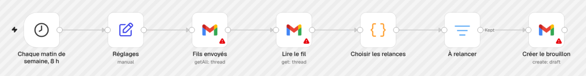

# Installer relance-radar, pas à pas

Ce guide part de zéro : tu n'as jamais importé un workflow n8n, tu n'as jamais branché Gmail. À la fin, chaque matin de semaine, tes relances t'attendent en brouillon dans Gmail. Rien ne part tout seul.

## Ce qu'il te faut

- **n8n**, en ligne (n8n Cloud) ou installé sur ton serveur. Le workflow a été testé sur n8n 2.47.4.
- **Le compte Gmail** qui envoie tes devis et tes courriels de prospection.
- Le fichier [workflow.json](workflow.json) de ce dossier.

## 1. Importer le workflow

1. Télécharge [workflow.json](workflow.json) : bouton **Download raw file** sur GitHub.
2. Dans n8n, crée un workflow vide.
3. Ouvre le menu du workflow (les trois points en haut du canevas), puis **Import from File**, et choisis `workflow.json`.

Tu dois voir 7 nœuds, comme sur l'image ci-dessus. Les 3 nœuds Gmail portent un triangle rouge : c'est normal, Gmail n'est pas encore branché. Le fichier ne contient aucun identifiant.

## 2. Brancher Gmail

Ouvre le nœud **Fils envoyés**, puis, dans **Credential to connect with**, choisis **Create new credential**.

### Sur n8n Cloud

Clique sur **Sign in with Google**, choisis ton compte Gmail et accepte. C'est tout.

### Sur ton propre serveur

n8n ne propose pas la connexion en un clic sur un serveur à toi : il faut créer une petite application Google. La marche à suivre officielle de n8n, résumée :

1. Dans la [Google Cloud Console](https://console.cloud.google.com/), crée un projet et vérifie qu'il est sélectionné en haut de l'écran.
2. **APIs & Services → Library** : cherche **Gmail API** et clique sur **Enable**.
3. **APIs & Services → OAuth consent screen** : **Get started**, donne un nom et ton adresse de contact, choisis le public (**External** pour un compte Gmail personnel). Dans **Branding**, ajoute le domaine de ton n8n aux **Authorized domains**.
4. **Credentials → Create credentials → OAuth client ID**, type **Web application**.
5. Dans n8n, copie l'**OAuth Redirect URL** affichée dans le formulaire de l'identifiant, et colle-la dans **Authorized redirect URIs** côté Google. Clique sur **Create**.
6. Colle le **Client ID** et le **Client Secret** dans n8n, clique sur **Sign in with Google**, puis enregistre.

Avec le public **External**, l'application reste en mode test :

- ajoute ton adresse Gmail dans **Audience → Test users**, sinon Google refuse la connexion (« access denied ») ;
- Google affiche « Google hasn't verified this app » : c'est ta propre application, tu peux continuer ;
- en mode test, la connexion expire au bout de 7 jours. Il faut alors la refaire dans n8n, depuis la fenêtre de l'identifiant.

Le détail est dans la [documentation de n8n](https://docs.n8n.io/integrations/builtin/credentials/google/oauth-single-service/).

### Sur les 3 nœuds Gmail

Choisis le même identifiant dans **Fils envoyés**, **Lire le fil** et **Créer le brouillon**. Les triangles rouges disparaissent.

## 3. Remplir les réglages

Ouvre le nœud **Réglages** :

| Champ | Ce que tu y mets | Par défaut |
|---|---|---|
| `mon_adresse` | l'adresse Gmail que tu viens de brancher, exactement | `toi@exemple.com` (à changer) |
| `jours_avant_relance` | combien de jours attendre après ton dernier message | 5 |
| `relances_max` | combien de relances au plus par personne | 2 |
| `fenetre_jours` | jusqu'où remonter dans tes courriels envoyés | 45 |
| `liste_exclusion` | les adresses ou domaines à ne jamais relancer, séparés par des virgules : `marie@exemple.com, @agence-perdue.com` | vide |
| `signature` | ta signature, en bas de chaque brouillon | `Ton prénom` |
| `date_du_jour` | **laisse vide** : ce champ sert seulement au test | vide |

## 4. Le premier lancement, à la main

1. Clique sur **Execute workflow** (ou **Test workflow**, selon ta version de n8n).
2. Ouvre le nœud **Choisir les relances** : une ligne par fil, avec `relancer` ou `ignorer` et la raison (« a répondu », « trop récent », « sur ta liste d'exclusion »…).
3. Ouvre Gmail, dossier **Brouillons** : une relance attend dans chaque fil à relancer. Rien n'est parti.
4. Relis 2 ou 3 brouillons. Si l'un vise quelqu'un que tu ne veux pas relancer, supprime-le et ajoute l'adresse à `liste_exclusion`.

## 5. L'activer

Active le workflow (bouton **Active** ou **Publish**, selon ta version). Il tourne du lundi au vendredi à 8 h, à l'heure de ton instance n8n. Pour une autre heure ou un autre fuseau, ouvre le nœud **Chaque matin de semaine, 8 h**, ou les réglages du workflow pour le fuseau.

Chaque matin, tu ouvres tes brouillons Gmail : tu envoies, tu modifies ou tu supprimes.

## 6. Le couper

Désactive le workflow. Les brouillons déjà créés restent dans Gmail.

## Si ça ne marche pas

| Ce que tu vois | Cause probable | Ce que tu fais |
|---|---|---|
| Un triangle rouge sur un nœud Gmail | aucun identifiant choisi sur ce nœud | choisis l'identifiant Gmail sur les 3 nœuds |
| Aucun brouillon | `mon_adresse` ne correspond pas à l'adresse qui envoie, tes messages ont moins de `jours_avant_relance` jours, ou aucun courriel envoyé dans la fenêtre | vérifie `mon_adresse`, puis regarde les raisons dans **Choisir les relances** |
| Une relance revient après que tu l'as supprimée | le workflow ne voit plus de brouillon dans le fil, donc il en prépare un autre | pour arrêter de relancer quelqu'un, ajoute son adresse à `liste_exclusion` |
| « access denied » chez Google | ton adresse n'est pas dans les utilisateurs test | ajoute-la dans **Audience → Test users** |
| `redirect_uri_mismatch` | l'adresse de redirection ne correspond pas | recopie l'**OAuth Redirect URL** de n8n telle quelle, protocole et port compris |
| `invalid_client` | Client ID ou Client Secret mal copié | recopie les deux, sans espace en trop |
| Plus rien après une semaine | la connexion Google en mode test a expiré (7 jours) | refais **Sign in with Google** dans l'identifiant |

## Ce que le workflow ne fait pas

- Il n'envoie aucun courriel. Il crée des brouillons, c'est tout.
- Il lit les en-têtes de tes courriels (expéditeur, destinataire, date, objet), jamais leur contenu.
- Il ne sait pas si quelqu'un t'a répondu par téléphone ou depuis une autre adresse : c'est le rôle de `liste_exclusion`.
- Une réponse automatique (absence du bureau) compte comme une réponse : le fil est ignoré.
- Les brouillons sont en français, au vouvoiement. Pour une autre langue, modifie les trois phrases dans le nœud **Choisir les relances**.

## Sources

- n8n, [Google OAuth2 single service](https://docs.n8n.io/integrations/builtin/credentials/google/oauth-single-service/), consulté le 13 novembre 2026.
- n8n, [Export and import workflows](https://docs.n8n.io/build/manage-workflows/export-and-import), consulté le 13 novembre 2026.

---

Fait par [Darius Tokam](https://tokamdarius.ca) · Arivex · Licence MIT
