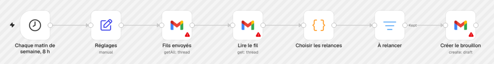

# relance-radar : un workflow n8n qui prépare tes relances, sans rien envoyer



Chaque matin de semaine, le workflow relit les courriels que tu as envoyés (devis, propositions, prospection), trouve ceux restés sans réponse, et prépare un brouillon de relance dans le même fil Gmail. Tu relis, tu envoies ou tu supprimes. Rien ne part tout seul.

| Nœud | Ce qu'il fait |
|---|---|
| Chaque matin de semaine, 8 h | lance le workflow du lundi au vendredi |
| Réglages | ton adresse, le délai avant relance, le nombre maximum de relances, ta liste d'exclusion, ta signature |
| Fils envoyés | liste les fils Gmail où tu as écrit ces 45 derniers jours |
| Lire le fil | lit les en-têtes de chaque fil (expéditeur, destinataire, date, étiquettes), jamais le corps |
| Choisir les relances | décide fil par fil : relancer, ou ignorer avec la raison |
| À relancer | garde les fils à relancer |
| Créer le brouillon | crée le brouillon dans le fil, adressé au destinataire du premier message |

Un fil est ignoré quand :

- la personne a répondu ;
- le message n'a pas été distribué (retour de `mailer-daemon`) ;
- l'adresse ou le domaine est sur ta liste d'exclusion (un prospect perdu, un client qui a dit non) ;
- un brouillon de relance attend déjà dans le fil : le workflow ne double jamais un brouillon d'un matin à l'autre ;
- tu as déjà relancé le nombre maximum de fois ;
- ton dernier message date de moins de jours que le délai choisi.

Relance n°1 : trois phrases, la date et l'objet du premier message, une question à laquelle on répond d'un mot. Relance n°2 : trois phrases, avec un autre levier (fermer le dossier ou caler un court appel).

## Installer

Le guide pas à pas est dans [GUIDE.md](GUIDE.md) : importer le fichier, brancher Gmail (n8n Cloud ou ton serveur), remplir les réglages, le premier lancement à la main, l'activation et les erreurs fréquentes.

En bref :

1. Télécharge [workflow.json](workflow.json), puis dans n8n : menu du workflow (les trois points), **Import from File**.
2. Branche ton identifiant Gmail sur les 3 nœuds Gmail : Fils envoyés, Lire le fil, Créer le brouillon. Le fichier ne contient aucun identifiant.
3. Remplis le nœud **Réglages** : ton adresse, le délai avant relance, le nombre de relances, ta liste d'exclusion, ta signature. Laisse `date_du_jour` vide.
4. Lance une fois à la main, relis les brouillons dans Gmail, puis active le workflow.

Les brouillons sont en français, au vouvoiement. Pour une autre langue, modifie les trois phrases dans le nœud **Choisir les relances**.

## Testé sur une boîte reconstituée

27 fils envoyés, dont la forme reprend un vrai cas de l'auteur (22 courriels de prospection en deux semaines, 0 réponse) : 15 brouillons, 0 brouillon pour un prospect exclu, une personne qui a répondu, une adresse en erreur, un fil déjà relancé deux fois ou un fil qui avait déjà son brouillon. Un second passage le lendemain crée 0 brouillon en double. Le même résultat sort de n8n (exécution de test avec données simulées) et du script de test. Le détail et la limite du test sont dans [test/RESULTS.md](test/RESULTS.md).

Pour rejouer le test (Python 3.10+ et Node.js) :

```bash
python test/build_threads.py /tmp/relance-cases
python test/run_checks.py /tmp/relance-cases
```

---

Fait par [Darius Tokam](https://tokamdarius.ca) · Arivex · Licence MIT
